<p align="center">
  <picture><source media="(max-width: 767px)" srcset="assets/readme/banner-m.svg"></picture>
</p>

<p align="center">
  
  
  
</p>

A drowsy driver and a fainting driver look alike to a camera: eyes shut, head falling. This prototype watches the driver's face through a webcam and tells them apart by how long it lasts. A short closure gets an on-screen warning, a longer one sounds an alarm, and twelve seconds of closed eyes (or a collapsed head posture) also sends an emergency SMS through Twilio. It calibrates to each driver's own open-eye level first, so people with naturally narrow eyes don't trigger false alarms.

<p align="center">
  <picture><source media="(max-width: 767px)" srcset="assets/readme/proof-m.svg"></picture>
</p>

## Quick start

Tested on Windows with Python 3.10.

```powershell
git clone https://github.com/JustKamlesH21/driver-drowsiness-faint-detection.git
cd driver-drowsiness-faint-detection
python -m pip install -r requirements.txt
python main.py
```

Sit still and look at the camera for the first few seconds while the yellow calibration bar fills. Press `q` in the video window to quit.

SMS alerts are optional. To turn them on, create a `.env` file:

```dotenv
ACCOUNT_SID=your_twilio_account_sid
AUTH_TOKEN=your_twilio_auth_token
TWILO_PHONE=+1234567890
```

Then set the destination number in `TO_PHONE` near the top of `main.py`. Without valid keys the app prints `SMS disabled` and keeps running with sound alarms only.

## How it works

<p align="center">
  <picture><source media="(max-width: 767px)" srcset="assets/readme/how-it-works-m.svg"></picture>
</p>

1. **Calibrate.** For the first 60 frames it records your head pitch and roll and your open-eye *eye aspect ratio* (EAR, how open the eyelids are). Your closed-eye limit becomes 80% of your open value, kept between 0.16 and 0.28.
2. **Measure.** MediaPipe Face Mesh finds the eye and face landmarks in every frame. From them it computes EAR for both eyes and the head's pitch and roll.
3. **Decide.** Two checks run side by side:

   | Check | Trigger | Result |
   |---|---|---|
   | Eyes closed | 1.5 s | `DROWSY WARNING` on screen |
   | Eyes closed | 5.5 s | `Partially FAINT (SLEEP)`, alarm |
   | Eyes closed | 12 s | `FAINT (UNCONSCIOUS)`, alarm and one SMS |
   | Head posture | more than 15° down, 20° up or 25° tilted, for more than 8 frames in a row | `FAINT (POSTURE COLLAPSE)`, alarm and one SMS |

4. **Alert and log.** The alarm plays `alarm.wav` through pygame, or a `winsound` beep if the file is missing. Each new alert is written to `log.csv`.

All thresholds are constants at the top of `main.py` (`TIME_TIER_*`, `LIMIT_PITCH_*`, `LIMIT_ROLL`).

## Files

| File | What it is |
|---|---|
| `main.py` | The current system: calibration, three tiers, posture check, alarm, SMS |
| `drowsiness_system.py` | An earlier, simpler version that logs to `faint_drowsiness_log.csv` |
| `face_landmarker.task` | MediaPipe model file |
| `v0.01/` | The first attempt, with Haar cascades |

## Limits

- This is a prototype, not a certified safety device.
- Windows only as written: the fallback alarm uses `winsound`.
- The SMS carries a maps link. With `USE_EXACT_LOCATION = True` (the default) it uses the fixed `DEMO_LAT`/`DEMO_LNG` in `main.py`; set it to `False` to use an IP-based location from `geocoder`.

## License

No license file has been added yet, so default copyright applies.

<p align="center">
  <a href="https://github.com/JustKamlesH21"><picture><source media="(max-width: 767px)" srcset="assets/readme/footer-m.svg"></picture></a>
</p>
